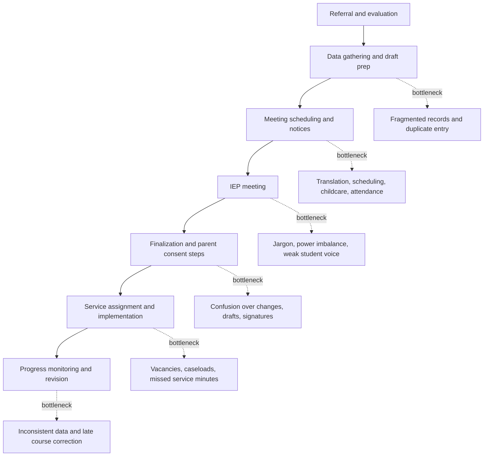

# IEP Implementation Workspace: Functional Design Spec, Goals, Source Appendix, and Pain-Point Research

**Working product name:** IEP Implementation Workspace  
**Prepared for:** Concept / functional design planning  
**Date:** June 22, 2026  
**Scope:** Pennsylvania-aware, AI-assisted IEP implementation platform for school-age special education workflows, with future support for early intervention and related forms.

---

## Table of Contents

1. [Product Summary](#1-product-summary)
2. [System Goals](#2-system-goals)
3. [Functional Design Spec](#3-functional-design-spec)
4. [Official Pennsylvania IEP Source Alignment](#4-official-pennsylvania-iep-source-alignment)
5. [Appendix A: Official Pennsylvania IEP Source Documents](#5-appendix-a-official-pennsylvania-iep-source-documents)
6. [Appendix B: IEP Process Pain Points Research](#6-appendix-b-iep-process-pain-points-research)
7. [Product Implications and Recommended MVP Priorities](#7-product-implications-and-recommended-mvp-priorities)
8. [Source List](#8-source-list)

---

# 1. Product Summary

The application is a structured IEP management and implementation workspace that helps school teams upload, understand, generate, review, implement, and monitor Individualized Education Programs.

The app should not be treated only as an “IEP generator.” Its stronger purpose is to convert a dense compliance document into a living implementation plan.

**Primary outcome:**

> Help teachers, families, students, and administrators understand what an IEP requires, who is responsible for each support, what data must be collected, and whether the plan is being implemented as written.

The product should help school teams move from document storage to plan implementation by turning goals, services, accommodations, progress-monitoring requirements, meeting information, and family/student input into role-specific tasks, summaries, dashboards, and review workflows.

---

# 2. System Goals

The goal of this system is to transform the Individualized Education Program from a static compliance document into a structured, actionable, and collaborative implementation workspace. The system is designed to help school teams, families, and students better understand what the IEP requires, how supports should be delivered, who is responsible for each action, and how student progress should be monitored over time.

The system should reduce the administrative burden associated with interpreting, summarizing, tracking, and communicating IEP requirements while preserving the professional judgment and legal responsibilities of the IEP team. It should help educators move from document management to plan implementation by turning goals, accommodations, services, progress-monitoring requirements, and meeting information into role-specific tasks, summaries, dashboards, and review workflows.

A central goal of the system is to improve shared understanding among all participants in the IEP process. Special education staff, general education teachers, related service providers, administrators, parents, guardians, and students should each be able to view the same plan through a lens appropriate to their role. The system should provide plain-language explanations, teacher-facing implementation checklists, parent-friendly summaries, student-facing supports, and administrator-facing review tools while maintaining fidelity to the official IEP.

The system should also support better follow-through on IEP commitments. Required accommodations, services, specially designed instruction, assessment supports, behavior supports, transition activities, and progress-monitoring obligations should be extracted from the IEP and converted into trackable actions. Staff should be able to see what is required, document implementation, enter progress data, and identify missing or stale information before it becomes a problem.

Another goal is to improve the quality and consistency of IEP documentation. The system should assist users in identifying incomplete, vague, inconsistent, or difficult-to-implement sections of an IEP, such as goals that are not measurable, services without clear frequency or duration, accommodations that lack context, or progress-monitoring plans that do not specify how data will be collected. These reviews should be advisory and human-reviewed, supporting better practice without replacing the IEP team’s decision-making authority.

The system should make the IEP process more transparent and accessible for families. Parents and guardians should be able to understand what supports are being provided, what progress is being measured, what services are required, and what questions they may want to raise during meetings. Where appropriate, students should also be supported in understanding their own goals, accommodations, and self-advocacy opportunities.

The system should support both active student plans and training or drafting workflows. For active plans, the system should help teams implement and monitor existing IEPs. For training and drafting, the system should help users create fictional or draft IEP examples, evaluate sample plans, and learn how strong IEP sections are structured.

The system should be secure, auditable, and role-aware. Sensitive student information should only be visible to authorized users. AI-generated content should be clearly labeled as draft, explanatory, or advisory. The system should preserve source documents, maintain an activity history, and distinguish between official IEP content, user-entered notes, and AI-generated suggestions.

Ultimately, the system should help schools deliver IEPs with greater clarity, consistency, accountability, and collaboration. Its purpose is to support the people responsible for implementing the plan, strengthen communication with families, improve progress monitoring, and make the IEP a living tool for student support rather than a document that is only revisited during formal meetings.

## Executive Goal Statement

The goal of the system is to make Individualized Education Programs easier to understand, implement, monitor, and improve. The system converts IEP documents into structured, role-specific workspaces that help educators, families, students, and administrators understand the plan, track responsibilities, monitor progress, and prepare for meetings.

Rather than replacing the IEP team or making legal determinations, the system supports human decision-making by extracting key obligations, generating plain-language summaries, creating teacher and provider checklists, organizing progress-monitoring workflows, and flagging areas that may need review. It helps ensure that accommodations, services, goals, and supports are not only documented, but also visible, actionable, and trackable.

The intended outcome is a more transparent, consistent, and collaborative IEP process where staff know what they are responsible for, families understand what the plan provides, students can better advocate for their supports, and administrators can identify implementation or documentation issues earlier.

---

# 3. Functional Design Spec

## 3.1 Product Goals

The app should:

1. Reduce paperwork and manual interpretation of IEP documents.
2. Convert IEPs into structured, reusable data.
3. Help staff implement accommodations, services, goals, and progress monitoring.
4. Provide parent-friendly and student-friendly explanations.
5. Support drafting, review, and training workflows using fictional or real student profiles.
6. Assist with quality and compliance review without replacing professional judgment.
7. Provide dashboards, reminders, and progress views for ongoing implementation.

## 3.2 Non-Goals

The MVP should not attempt to:

1. Replace qualified special education staff.
2. Automatically finalize legally binding IEPs without human review.
3. Make placement decisions independently.
4. Diagnose disabilities.
5. Guarantee legal compliance.
6. Replace the district’s official student information system or IEP system on day one.
7. Automatically communicate sensitive student information externally without approval.

## 3.3 Primary Users

### Special Education Teacher / Case Manager

Primary operational user.

Needs to:

- Upload or create student IEPs.
- View required accommodations and services.
- Track progress monitoring.
- Prepare for IEP meetings.
- Generate summaries for teachers and parents.
- Monitor whether required supports are being delivered.

### General Education Teacher

Receives role-specific obligations.

Needs to know:

- What accommodations apply in their classroom.
- What modifications or supports are required.
- What data or observations they need to provide.
- What they should do daily, weekly, or during assessments.

### Parent / Guardian

Needs plain-language visibility.

Needs to know:

- What the plan says.
- What services the student should receive.
- How goals are measured.
- What progress has been made.
- What questions to ask at meetings.

### Student

Optional role, depending on age and district policy.

Needs to know:

- What supports are available.
- What goals they are working toward.
- How to advocate for accommodations.
- Transition-related tasks, when applicable.

### Administrator / Compliance Reviewer

Needs oversight.

Needs to know:

- Whether IEPs are complete.
- Whether services are being tracked.
- Whether deadlines are approaching.
- Whether plans have vague, missing, or inconsistent sections.
- Whether required sections are present.

## 3.4 Core Product Concept

The system should maintain each IEP as both:

1. **A source document**  
   The uploaded or generated IEP file, such as PDF, Word, or pasted text.

2. **A structured IEP record**  
   A normalized JSON representation of the IEP.

The structured record should include sections such as:

```json
{
  "studentInformation": {},
  "IEPTeam": [],
  "specialConsiderations": {},
  "currentPerformance": {},
  "goalsAndObjectives": [],
  "services": [],
  "supplementaryAidsAndServices": [],
  "accommodations": [],
  "educationalPlacement": {},
  "meetingInformation": {},
  "transitionServices": {},
  "stateAndLocalAssessments": {},
  "behaviorSupportPlan": {},
  "progressMonitoring": [],
  "additionalInformation": {}
}
```

## 3.5 Core Workflows

### 3.5.1 IEP Intake Workflow

**Purpose:** Allow a user to upload or paste an existing IEP and convert it into structured data.

**Steps:**

1. User creates or selects a student.
2. User uploads IEP document or pastes IEP text.
3. System extracts document text.
4. AI assistant identifies major IEP sections.
5. System maps extracted content into structured fields.
6. User reviews extracted sections.
7. User confirms, edits, or rejects extracted data.
8. System creates an active IEP workspace.

**Required features:**

- Upload PDF, DOCX, or text.
- Manual paste option.
- Section detection.
- Confidence indicators for extracted fields.
- Human review screen before saving.
- Original source document preserved.
- Extracted fields linked back to source text where possible.

**Example extracted sections:**

- Student information
- IEP team
- Meeting dates
- Present levels / current performance
- Special considerations
- Goals and objectives
- Services
- Supplementary aids
- Accommodations
- State and local assessments
- Transition services
- Educational placement
- Progress monitoring

### 3.5.2 IEP Drafting Workflow

**Purpose:** Help staff draft IEP sections from a student profile, meeting notes, assessment data, or an annotated sample.

This may also support fictional IEP generation for training.

**Steps:**

1. User selects “Create Draft IEP.”
2. User enters student profile information.
3. User answers guided questions.
4. System generates draft sections.
5. User reviews each section.
6. User accepts, edits, or regenerates sections.
7. System assembles a draft IEP package.

**Required features:**

- Guided intake questionnaire.
- Draft section generation.
- Annotated sample IEP support.
- “Generate fictional training IEP” mode.
- Editable draft sections.
- Version history.
- Human approval required before export.

**Key drafting sections:**

- Present levels
- Special considerations
- Measurable annual goals
- Short-term objectives, when required
- Services and supports
- Supplementary aids
- Assessment accommodations
- Behavior support plan
- Transition services
- Educational placement rationale

### 3.5.3 IEP Explanation Workflow

**Purpose:** Translate complex IEP language into plain-language summaries.

The same IEP should be explainable differently depending on the audience.

**Teacher summary includes:**

- Required accommodations
- Service obligations
- Classroom supports
- Goal areas
- Data collection responsibilities
- Assessment accommodations
- Behavior supports
- Important dates

**Parent summary includes:**

- What the school is providing
- What each goal means
- How progress will be measured
- What services are required
- What questions to ask at the next meeting
- What changed from the previous IEP

**Student summary includes:**

- My goals
- My supports
- How to ask for help
- What I am working on
- Transition activities, if applicable

**Admin summary includes:**

- Missing sections
- Ambiguous services
- Unclear progress monitoring
- Timeline issues
- Placement rationale
- Compliance flags

### 3.5.4 Implementation Checklist Workflow

**Purpose:** Convert the IEP into actionable responsibilities.

This is the most important MVP workflow.

**Steps:**

1. System reads structured IEP.
2. System identifies obligations.
3. System groups obligations by responsible role.
4. System creates checklists and recurring tasks.
5. Staff can mark tasks complete, add notes, and attach evidence.
6. Case manager can monitor status.

**Example checklist item for a general education teacher:**

```text
Student: [Name]
Class: English

Required supports:
- Provide extended time on tests.
- Allow use of graphic organizer for writing tasks.
- Provide written directions in addition to verbal directions.
- Check for understanding after multi-step instructions.

Data needed:
- Weekly note on assignment completion.
- Record test accommodation usage.
```

**Example checklist item for a case manager:**

```text
Progress monitoring:
- Collect reading fluency data weekly.
- Update goal progress every grading period.
- Review service delivery logs monthly.
- Prepare parent progress report before reporting period closes.
```

### 3.5.5 Progress Monitoring Workflow

**Purpose:** Track measurable annual goals and related data collection.

**Steps:**

1. System extracts goals and measurement criteria.
2. User confirms measurement method.
3. System creates progress monitoring schedule.
4. Staff enter data points.
5. System charts progress over time.
6. System generates progress report language.
7. System flags goals without recent data.

**Required features:**

- Goal dashboard.
- Data entry form.
- Measurement schedule.
- Evidence upload.
- Notes field.
- Progress charting.
- “Insufficient data” warnings.
- Draft progress report generator.

**Goal data model:**

```json
{
  "goalId": "goal-001",
  "domain": "Reading",
  "baseline": "Student reads 42 words correct per minute.",
  "annualGoal": "Student will read 90 words correct per minute with 95% accuracy.",
  "measurementMethod": "Weekly oral reading fluency probe",
  "frequency": "Weekly",
  "responsibleStaff": ["Reading Specialist", "Case Manager"],
  "criteriaForMastery": "90 WCPM across 3 consecutive probes",
  "progressData": []
}
```

### 3.5.6 Quality and Compliance Review Workflow

**Purpose:** Help reviewers identify missing, vague, inconsistent, or risky IEP sections.

The app should flag:

- Missing present levels.
- Goals not connected to present levels.
- Goals that are not measurable.
- Services without frequency, duration, or location.
- Accommodations written too vaguely.
- Missing progress monitoring method.
- Missing state/local assessment information.
- Missing transition services when age-appropriate.
- Missing special considerations.
- Unclear educational placement rationale.
- Behavior needs not addressed when behavior is identified.
- Inconsistency between services and placement.
- Missing meeting information or team members.

**Output example:**

```text
Issue: Goal lacks clear measurement method.
Severity: Medium
Section: Goals and Objectives
Why it matters: Staff may not know how progress should be tracked.
Suggested revision: Add a specific assessment, frequency, and mastery criterion.
Human review required: Yes
```

### 3.5.7 Meeting Preparation Workflow

**Purpose:** Help staff and families prepare for IEP meetings.

**Case manager meeting prep includes:**

- Current goals and progress.
- Services delivered.
- Missing data.
- Parent concerns.
- Teacher feedback.
- Draft agenda.
- Questions to resolve.
- Proposed changes.

**Parent meeting prep includes:**

- Plain-language summary.
- Current goals.
- Progress since last meeting.
- Services being provided.
- Suggested questions.
- Notes area.

**Administrator meeting prep includes:**

- Compliance status.
- Timeline status.
- Required participants.
- Risk flags.
- Draft agenda.

## 3.6 Major Screens

### Dashboard

**Teacher / case manager dashboard cards:**

- Students on caseload
- Upcoming IEP meetings
- Progress data due
- Services needing logs
- IEPs needing review
- Recent parent summaries
- Compliance alerts

**Admin dashboard cards:**

- IEPs due soon
- Overdue progress reports
- Missing service logs
- Drafts pending review
- Compliance flags by school/building
- Caseload overview

### Student Profile

Tabs:

1. Overview
2. IEP Document
3. Plan Summary
4. Goals
5. Services
6. Accommodations
7. Progress Monitoring
8. Meeting Prep
9. Compliance Review
10. Documents
11. Activity Log

### IEP Document Viewer

Layout:

- Left: original document
- Right: extracted structured sections
- Highlight: source-to-field mapping
- Controls: confirm, edit, flag, regenerate

### Plan Summary Screen

Controls:

- View as teacher
- View as parent
- View as student
- View as admin
- Export summary
- Copy to clipboard
- Generate meeting handout

### Goals and Progress Screen

Elements:

- Goal cards
- Baseline
- Annual goal
- Measurement method
- Data entry
- Chart
- Last data point
- Progress status
- Draft progress report language

Statuses:

- On track
- Monitor closely
- Insufficient data
- Not on track
- Goal mastered
- Needs review

### Services and Accommodations Screen

Sections:

- Specially designed instruction
- Related services
- Supplementary aids and services
- Classroom accommodations
- Assessment accommodations
- Behavior supports
- Transportation, if applicable
- Assistive technology, if applicable

Each item should show:

- Description
- Frequency
- Duration
- Location
- Responsible role
- Start date
- End date
- Evidence/logging requirement
- Source section

### Compliance Review Screen

Elements:

- Overall review status
- Missing section checklist
- Quality flags
- Severity
- Suggested revision
- Source reference
- Mark as resolved
- Export review report

### AI Assistant Panel

The assistant should be context-aware and able to answer questions such as:

- “What accommodations does this student need in math?”
- “What progress data is due this week?”
- “Explain this IEP to a parent.”
- “Are the goals measurable?”
- “What should I prepare before the meeting?”
- “Generate a teacher checklist.”
- “Draft a parent-friendly summary.”
- “What services are listed and how often?”

The assistant should always distinguish between:

- Extracted IEP content
- User-entered notes
- AI-generated suggestions
- Compliance warnings requiring human review

## 3.7 Functional Requirements

### Document Upload

The system shall allow users to upload IEP documents.

Supported inputs for MVP:

- PDF
- DOCX
- Plain text
- Copy/paste

The system shall preserve the original document.

The system shall not overwrite original documents.

### Structured Extraction

The system shall extract IEP content into structured sections.

The user shall be able to review and edit extracted data before finalizing.

The system shall show confidence levels for extracted sections when available.

The system shall preserve source references where possible.

### Schema-Based IEP Record

Required top-level sections:

```text
studentInformation
IEPTeam
specialConsiderations
currentPerformance
goalsAndObjectives
services
supplementaryAidsAndServices
accommodations
educationalPlacement
meetingInformation
transitionServices
stateAndLocalAssessments
behaviorSupportPlan
progressMonitoring
additionalInformation
```

### Role-Specific Views

The system shall generate different summaries for:

- Special education teacher
- General education teacher
- Parent/guardian
- Student
- Administrator/compliance reviewer

### Implementation Tasks

The system shall generate tasks from IEP obligations.

Task fields:

```json
{
  "taskId": "task-001",
  "studentId": "student-001",
  "sourceSection": "Accommodations",
  "title": "Provide extended time on assessments",
  "description": "Student receives 1.5x time on classroom assessments.",
  "responsibleRole": "General Education Teacher",
  "frequency": "As needed",
  "evidenceRequired": false,
  "status": "Active"
}
```

### Progress Monitoring

The system shall allow staff to enter progress data for each goal.

The system shall display progress over time.

The system shall flag missing or stale progress data.

The system shall help draft progress report language based on entered data.

### Compliance Review

The system shall perform AI-assisted review of IEP completeness and quality.

The system shall flag issues but not make final compliance determinations.

Every AI-generated compliance recommendation shall require human review.

### Export

The system shall support exports for:

- Parent summary
- Teacher checklist
- Meeting prep packet
- Compliance review report
- Progress report draft
- Structured JSON record

Potential later exports:

- Full draft IEP
- DOCX
- PDF
- District-system compatible format

### Audit and Activity Log

The system shall log:

- Document upload
- Extraction completed
- User edits
- AI-generated summaries
- Tasks created
- Progress data entered
- Compliance flags resolved
- Exports generated

## 3.8 AI Functional Requirements

### AI Assistant Capabilities

The AI assistant shall support:

1. IEP extraction.
2. Section summarization.
3. Plain-language explanation.
4. Teacher checklist generation.
5. Parent summary generation.
6. Student-friendly explanation.
7. Goal measurability review.
8. Progress monitoring support.
9. Meeting prep generation.
10. Draft IEP section generation.
11. Fictional IEP generation for training.

### AI Guardrails

The AI assistant shall:

- Clearly label generated content as draft or suggestion.
- Avoid making legal conclusions.
- Avoid diagnosing disabilities.
- Avoid changing IEP obligations without user approval.
- Refer users to qualified school personnel for final decisions.
- Preserve source references when summarizing.
- Ask for missing information when drafting legally sensitive sections.
- Avoid inventing services, accommodations, or placement decisions when summarizing an existing IEP.

### AI Response Modes

The assistant should support several output modes:

```text
Explain
Summarize
Checklist
Review
Draft
Compare
Prepare for meeting
Generate fictional training example
```

## 3.9 Permissions and Access Control

Suggested roles:

```text
System Administrator
District Administrator
School Administrator
Special Education Teacher
General Education Teacher
Related Service Provider
Parent/Guardian
Student
Read-Only Reviewer
```

### Special Education Teacher

Can:

- View assigned students.
- Upload IEP documents.
- Edit structured data.
- Generate summaries.
- Track progress.
- Prepare meeting materials.

### General Education Teacher

Can:

- View assigned accommodations.
- View relevant summaries.
- Add implementation notes.
- Enter classroom observations.
- Mark checklist items complete.

Cannot:

- View unrelated sensitive sections unless permitted.
- Modify official IEP record.

### Parent / Guardian

Can:

- View parent-friendly summaries.
- View goals and progress summaries.
- Access meeting prep documents.
- Submit questions or concerns.

Cannot:

- Edit official IEP data directly.

### Administrator

Can:

- View compliance dashboards.
- Review plans across caseloads.
- Resolve compliance flags.
- Export reports.

## 3.10 Data Model

### Student

```json
{
  "studentId": "student-001",
  "firstName": "string",
  "lastName": "string",
  "grade": "string",
  "school": "string",
  "caseManagerId": "user-001",
  "status": "Active"
}
```

### IEP

```json
{
  "iepId": "iep-001",
  "studentId": "student-001",
  "documentId": "doc-001",
  "meetingDate": "2026-06-22",
  "startDate": "2026-07-01",
  "endDate": "2027-06-30",
  "status": "Draft | Active | Archived",
  "structuredRecord": {}
}
```

### Goal

```json
{
  "goalId": "goal-001",
  "iepId": "iep-001",
  "domain": "Reading",
  "presentLevelReference": "currentPerformance.reading",
  "baseline": "string",
  "goalText": "string",
  "measurementMethod": "string",
  "frequency": "Weekly",
  "criteriaForMastery": "string",
  "responsibleStaff": [],
  "progressEntries": []
}
```

### Service

```json
{
  "serviceId": "service-001",
  "iepId": "iep-001",
  "serviceType": "Speech Therapy",
  "frequency": "2x/week",
  "duration": "30 minutes",
  "location": "Small group setting",
  "providerRole": "Speech-Language Pathologist",
  "startDate": "2026-07-01",
  "endDate": "2027-06-30"
}
```

### Accommodation

```json
{
  "accommodationId": "acc-001",
  "iepId": "iep-001",
  "description": "Extended time on assessments",
  "setting": "Classroom and state/local assessments",
  "responsibleRole": "General Education Teacher",
  "frequency": "As needed",
  "sourceReference": "stateAndLocalAssessments"
}
```

### Progress Entry

```json
{
  "entryId": "progress-001",
  "goalId": "goal-001",
  "date": "2026-09-15",
  "value": "72 WCPM",
  "notes": "Weekly oral reading fluency probe",
  "enteredBy": "user-001",
  "evidenceDocumentId": "doc-002"
}
```

## 3.11 MVP Scope

### MVP Name

**IEP Implementation Workspace**

### MVP Objective

Upload an IEP, extract key obligations, generate role-specific checklists, and track progress monitoring.

### Include

1. Student profile.
2. IEP upload.
3. Structured extraction.
4. Human review of extracted sections.
5. Plan summary.
6. Teacher checklist.
7. Parent-friendly summary.
8. Goals dashboard.
9. Progress monitoring entry.
10. Services and accommodations list.
11. Basic compliance review.
12. AI assistant for Q&A over the IEP.

### Exclude from MVP

1. Full district SIS integration.
2. Automated official IEP submission.
3. Parent e-signature workflow.
4. Calendar integration.
5. Medicaid/service billing.
6. Automated legal compliance certification.
7. Multi-district configuration.
8. Advanced analytics.
9. Real-time collaboration.
10. Fully automated IEP generation.

## 3.12 Future Enhancements

Later versions could add:

- District IEP system integration.
- Calendar reminders.
- Parent portal.
- Student self-advocacy portal.
- Service delivery logs.
- Meeting recording and transcript summarization.
- Version comparison between old and new IEPs.
- Team collaboration and comments.
- Progress charts and automated reporting.
- Admin analytics.
- Compliance audit packs.
- External data/tool querying.
- Code interpreter for plotting/charting progress data.
- Integration with assessment systems.
- PennData-style reporting support, if relevant to the operating environment.

## 3.13 Example User Stories

### Case Manager

As a case manager, I want to upload an IEP and automatically generate a teacher checklist so that every teacher knows what supports to provide.

### General Education Teacher

As a general education teacher, I want a simple list of required accommodations so that I can follow the IEP without reading the entire document.

### Parent

As a parent, I want the IEP explained in plain language so that I understand what support my child should receive.

### Administrator

As an administrator, I want to see IEPs with missing or vague sections so that I can review plans before meetings.

### Related Service Provider

As a service provider, I want to see service frequency, duration, and goals connected to my role so that I can document support accurately.

### Training User

As a trainer, I want to generate fictional IEPs from sample profiles so that new staff can practice reviewing and implementing plans.

## 3.14 Acceptance Criteria

### IEP Upload

Given a user uploads an IEP document, the system should extract recognizable sections and present them for review.

Success means:

- Original document is preserved.
- Structured fields are populated.
- User can edit extracted fields.
- User can approve extraction.

### Teacher Checklist

Given an approved structured IEP, the system should generate a teacher-facing checklist.

Success means:

- Accommodations are listed clearly.
- Services are separated from classroom supports.
- Responsibilities are grouped by role.
- Checklist avoids legal jargon where possible.

### Parent Summary

Given an approved structured IEP, the system should generate a parent-friendly explanation.

Success means:

- Goals are explained plainly.
- Services are summarized.
- Progress monitoring is described.
- The summary does not alter the meaning of the IEP.

### Progress Monitoring

Given a goal with a measurement method, the user should be able to enter progress data.

Success means:

- Data point is saved.
- Goal status updates.
- Progress history is visible.
- Missing data can be flagged.

### Compliance Review

Given a structured IEP, the system should identify likely missing or unclear sections.

Success means:

- Flags include severity.
- Flags explain why the issue matters.
- Suggested revisions are marked as suggestions.
- Human review is required to resolve flags.

## 3.15 Recommended Initial Build Sequence

### Phase 1: Structured IEP Workspace

Build:

- Student profile
- IEP upload
- Structured extraction
- Review/edit interface
- Original document viewer

### Phase 2: Implementation Outputs

Build:

- Teacher checklist
- Parent summary
- Services/accommodations screen
- AI Q&A over IEP

### Phase 3: Progress Monitoring

Build:

- Goals dashboard
- Progress data entry
- Progress chart
- Draft progress report language

### Phase 4: Compliance Review

Build:

- Completeness review
- Quality flags
- Suggested revisions
- Export review report

### Phase 5: Drafting and Training

Build:

- Guided IEP drafting
- Fictional student IEP generation
- Annotated sample support
- Version history

## 3.16 One-Sentence Product Definition

**The IEP Web Application is a secure, AI-assisted workspace that transforms Individualized Education Programs from static compliance documents into structured, role-specific implementation plans with checklists, summaries, progress monitoring, meeting prep, and human-reviewed quality checks.**

---

# 4. Official Pennsylvania IEP Source Alignment

The system should align its IEP schema, extraction logic, guided review workflows, and field-level help text with official Pennsylvania Department of Education and PaTTAN IEP forms wherever the product is being used for Pennsylvania school-age or early intervention special education workflows.

For Pennsylvania school-age IEP workflows, the current non-annotated PaTTAN Individualized Education Program form should be treated as the baseline structural reference for the system’s data model. The annotated PaTTAN IEP should be treated as the primary guidance reference for field descriptions, validation rules, quality review prompts, user-facing explanations, and AI-assisted drafting or review workflows.

The system should maintain a configurable source registry so that form versions, effective dates, document types, and jurisdiction-specific requirements can be tracked over time. This is important because IEP forms and guidance may be revised periodically. The application should not hard-code a single form version without preserving version metadata.

The system should clearly distinguish between:

- official source-document content;
- user-entered information;
- extracted structured data;
- AI-generated summaries or suggestions;
- advisory compliance or quality review flags.

For Pennsylvania deployments, any AI-assisted review, summary, checklist, or drafting workflow should remain grounded in the official PaTTAN/PDE form structure and should require human review before being treated as part of an official IEP process.

---

# 5. Appendix A: Official Pennsylvania IEP Source Documents

## A.1 Purpose of This Appendix

This appendix identifies official Pennsylvania Department of Education and PaTTAN source documents that should be used to guide the system’s Pennsylvania IEP workflows. These sources should inform the application’s schema design, document extraction logic, field definitions, guided user interface, review prompts, and AI-assisted explanation or drafting features.

The application should treat these sources as authoritative references for Pennsylvania-specific IEP structure and terminology, while still requiring qualified human review for any official IEP decision, revision, or compliance determination.

## A.2 Official Source Registry

The system should maintain an internal source registry for official IEP-related forms and guidance. Each source should be stored with metadata that allows the product team to track form version, effective date, document type, jurisdiction, intended age/program, and product use.

Recommended metadata fields:

```json
{
  "sourceId": "string",
  "title": "string",
  "issuingOrganization": "string",
  "sourceType": "Form | Annotated Form | Guidance | Companion Checklist | Related Notice",
  "programArea": "School Age | Preschool Early Intervention | Infant-Toddler Early Intervention | Gifted | Other",
  "jurisdiction": "Pennsylvania",
  "effectiveDate": "YYYY-MM-DD",
  "retrievedDate": "YYYY-MM-DD",
  "url": "string",
  "fileTypesAvailable": ["PDF", "DOCX", "HTML"],
  "productUse": ["Schema", "Extraction", "Field Help", "Validation", "Review", "Training"]
}
```

## A.3 Primary School-Age IEP Sources

### A.3.1 Individualized Education Program — School Age, Non-Annotated

This source should be treated as the baseline structural reference for Pennsylvania school-age IEP workflows.

Recommended system use:

- canonical section structure;
- top-level IEP schema design;
- field ordering;
- required section detection;
- document parsing and extraction;
- export template alignment;
- version-specific form recognition.

Product guidance:

The non-annotated school-age IEP should define the system’s core Pennsylvania IEP data model. When the app extracts an uploaded IEP, it should attempt to map source content back to the major sections and field groupings represented in the official form.

### A.3.2 Individualized Education Program — School Age, Annotated

This source should be treated as the primary guidance reference for Pennsylvania school-age IEP workflows.

Recommended system use:

- field-level help text;
- guided data entry instructions;
- quality review rules;
- AI review prompts;
- plain-language explanations;
- drafting support;
- training workflows;
- source-grounded user assistance.

Product guidance:

The annotated IEP should inform how the app explains each section to users, how it evaluates whether a section is complete enough for review, and how it helps users understand what information belongs in each part of the IEP. The annotated version should not be copied blindly into generated content, but should guide system behavior and instructional support.

## A.4 PaTTAN Special Education and Gifted Forms Hub

The PaTTAN Special Education and Gifted Forms hub should be treated as the official registry location for Pennsylvania school-age special education forms.

Recommended system use:

- source discovery;
- periodic form-version review;
- multilingual form availability awareness;
- related form identification;
- companion resource tracking.

Product guidance:

The system should not assume that the IEP form exists in isolation. The forms hub should be used to identify related Pennsylvania special education documents that may become part of future workflows, including meeting invitations, notices, consent forms, procedural safeguards, evaluation documents, and companion checklists.

## A.5 Early Intervention IEP Sources

Pennsylvania Early Intervention forms should be tracked separately from school-age IEP forms.

Recommended system use:

- future preschool or early intervention support;
- early intervention schema extensions;
- separate form recognition;
- separate guided workflows;
- family-facing explanation workflows.

Product guidance:

The MVP should focus on school-age IEP implementation unless early intervention support is explicitly in scope. However, the architecture should allow early intervention forms to be added later without forcing them into the school-age schema. Early intervention IEPs may have different structure, terminology, service models, and family engagement patterns.

## A.6 Related Forms and Companion Documents

The system should anticipate future support for related Pennsylvania special education documents, including but not limited to:

- Invitation to Participate in the IEP Team Meeting;
- Invitation to Participate in a Transition Meeting;
- Notice of Recommended Educational Placement / Prior Written Notice;
- Procedural Safeguards Notice;
- Permission to Evaluate;
- Permission to Reevaluate;
- Parent Consent to Excuse Members from IEP Meeting;
- Evaluation Report;
- Reevaluation Report;
- Annotated companion checklists;
- assessment accommodation guidance;
- transition-related forms or notices.

These documents should be treated as adjacent workflow documents rather than core IEP sections unless they are explicitly integrated into a district workflow.

## A.7 Product Design Implications

The official Pennsylvania source documents should influence the application in the following ways.

### Schema Design

The official non-annotated IEP form should define the baseline schema structure for Pennsylvania school-age IEP records. The schema should be versioned so that future changes to the official form can be supported without breaking older student records.

### Extraction Logic

Document extraction should attempt to identify and preserve official section headings, field labels, and source references. Extracted content should retain traceability back to the uploaded source document when possible.

### Guided User Interface

The annotated IEP should inform tooltips, section descriptions, review prompts, and guided form-entry workflows. Users should be able to understand why each section exists and what type of information belongs there.

### AI-Assisted Review

AI review should compare the structured IEP record against expected Pennsylvania IEP sections and flag potentially missing, vague, or inconsistent content. Review outputs should be advisory and should require human confirmation.

### Plain-Language Summaries

Parent, teacher, student, and administrator summaries should remain faithful to the official IEP content. The system may simplify language, but it should not alter obligations, invent services, or reinterpret placement decisions beyond the source material.

### Training and Drafting

Annotated forms may be used to guide training examples, fictional student IEP generation, and draft review workflows. Any generated draft should be clearly marked as draft content requiring qualified professional review.

### Version Control

The system should store the official form version and effective date associated with each IEP record when known. This allows the application to distinguish between IEPs created under different form versions or guidance periods.

## A.8 Recommended Initial Source Priority

For the MVP, sources should be prioritized as follows:

1. Current Pennsylvania school-age non-annotated IEP form.
2. Current Pennsylvania school-age annotated IEP form.
3. PaTTAN Special Education and Gifted Forms hub.
4. Early Intervention IEP forms, for future expansion.
5. Related Pennsylvania special education forms such as NOREP/PWN, meeting invitations, procedural safeguards, and evaluation documents.

## A.9 MVP Requirement Added by This Appendix

The MVP should include a Pennsylvania source-alignment layer that records which official form version was used to structure, extract, review, or explain an IEP.

Minimum requirement:

```json
{
  "jurisdiction": "Pennsylvania",
  "programArea": "School Age",
  "sourceForm": "Individualized Education Program",
  "sourceFormType": "Non-Annotated",
  "effectiveDate": "YYYY-MM-DD",
  "sourceRegistryVersion": "string"
}
```

This metadata should be attached to each structured IEP record and used by the system when generating summaries, checklists, compliance review flags, and exports.

---

# 6. Appendix B: IEP Process Pain Points Research

## B.1 Executive Summary

The most consequential pain points in the IEP process are not primarily about the form itself. They are about the operating system around the form: staffing shortages, documentation and compliance burden, weak coordination across teams, parent information and language barriers, limited student voice, and dispute-prone meeting dynamics. In practice, these problems reinforce one another. Shortages raise caseloads; heavy caseloads push work into rushed or defensive processes; rushed processes reduce trust and increase the odds of conflict, missed services, and weak implementation.

Several quantitative signals show the strain is systemic, not anecdotal. U.S. Department of Education data cited in a 2025 Dear Colleague Letter show more than 7.0 million students were served under IDEA Part B in 2022–23. NCES reported that, before the 2024–25 school year, 74% of elementary schools and 74% of middle schools with a special education vacancy had difficulty filling it with a fully certified teacher. GAO found staffing shortages were named by all 32 entities it visited as a key obstacle to educating students with disabilities, and that 44% of students with disabilities attended schools reporting no psychologist in 2020–21.

The teacher-facing evidence is especially consistent. GAO summarized prior research showing special education teachers spending about one hour per day on forms and paperwork, with educator focus groups estimating closer to two to three hours per day on administrative tasks. Recent federal budget justification language explicitly links paperwork burden to stress, burnout, and attrition. Peer-reviewed and scholarly reviews further connect teacher burnout to poorer student outcomes and lower IEP goal attainment.

Parent-facing pain points are also well documented. IDEA requires schools to ensure parent participation, and parents are required members of the IEP team. Yet peer-reviewed studies show parents often feel least knowledgeable about the legal side of special education, frequently want more information about advocacy and inclusion in general classrooms, and can be inhibited by jargon, cultural mismatch, or language barriers. OSEP has stated that IEPs are vital documents that must be accessible to limited-English-proficient parents, including through translation or complete oral interpretation where appropriate.

Student-facing pain points are narrower in the literature but still clear. A large national survey found only about one-third of students attended their most recent IEP meeting, and most who attended did not participate actively. Other research shows that IEP goals for some students, especially those with extensive support needs, can tilt toward compliance rather than meaningful skill-building or self-determination, while new evidence suggests self-determination is positively associated with IEP goal attainment.

The product implication is straightforward: the highest-value app is not merely an IEP drafting tool. It is a workflow layer that reduces coordination failure under legal constraints. The strongest feature candidates are a service-delivery and missed-minutes tracker, collaborative meeting preparation and shared agenda tools, plain-language and multilingual parent supports, a student voice module, role-based implementation handoffs, and a conflict-prevention decision log.

## B.2 Evidence Base and Analytical Frame

This research prioritizes official and primary U.S. sources first, then peer-reviewed research, then high-quality advocacy and lived-experience sources. The legal baseline comes from IDEA regulations on IEP team composition, parent participation, IEP content, implementation, review, and staff access to the IEP. Unless explicitly marked Pennsylvania-specific, findings below assume the general U.S. IDEA framework.

The analytical attributes used for each pain point were:

- stakeholder group;
- apparent frequency;
- root causes;
- anonymized examples;
- implementation and compliance impact;
- legal or administrative constraints;
- product features that could mitigate the problem.

“Frequency” below is a synthesis label:

- **Very high:** repeated across multiple official and peer-reviewed sources with at least some quantitative support.
- **High:** repeated across multiple credible sources but less directly quantified.
- **Moderate:** credible but narrower or more context-specific evidence.

This is a synthesis judgment, not a formal meta-analysis.

## B.3 Compact Prevalence Snapshot

| Issue | Best quantitative signal found | Why it matters |
|---|---:|---|
| Difficulty filling special education vacancies | 74% of elementary schools and 74% of middle schools with a special education vacancy reported difficulty filling it with a fully certified teacher before 2024–25. | Directly affects service capacity, continuity, and implementation. |
| Missing key support staff | 44% of students with disabilities attended schools with no psychologist reported at the school in 2020–21. | Evaluations, progress review, and IEP development become harder. |
| Student absence from their own IEP meeting | Only about one-third of students attended their most recent IEP meeting in a large parent survey. | Student voice and self-advocacy are often weak by default. |
| Parent knowledge gaps | In one survey of 133 parents, the most commonly desired “wish I knew more” topics were regular-classroom instruction, advocacy, and how special education services work. Parents reported least knowledge on legal aspects and dispute resolution. | Families may participate formally but not equitably. |
| Formal disputes | In 2020–21, IDEA Part B recorded 23,567 due process complaints and 8,725 mediation requests. | Escalated conflict is not rare, even if it remains a minority of all cases. |

## B.4 Process Bottleneck Model



This flow reflects the legal reality that schools must ensure parent participation, include required team members, make services available as soon as possible after the IEP is developed, review IEPs at least annually, and ensure responsible staff can access the IEP. Those rules protect rights, but they also mean process breakdowns quickly become compliance risks.

## B.5 Stakeholder Pain Points

| Pain point | Stakeholder group | Frequency | Root causes | Examples / signals | Impact | Product features |
|---|---|---|---|---|---|---|
| Documentation and compliance overload crowd out instruction | Teacher, admin | Very high | Federal, state, and local paperwork requirements; duplicate entry; fear of complaints; case management and instruction folded into one role. | GAO and teacher reports describe paperwork as a persistent burden. | Less time for instruction, planning, and progress monitoring; burnout and attrition. | One-time data entry; auto-populated sections; deadline engine; reusable goal/service templates; case-management view. |
| Staffing shortages and unstable service delivery | Teacher, parent, student, admin | Very high | Too few qualified staff; low pay; high caseloads; paperwork; fatigue. | NCES vacancy data and GAO reports document special education staffing challenges. | Missed services, delayed evaluations, continuity problems, reliance on contractors. | Service-minute tracker; missed-service recovery workflow; workload dashboard; continuity planning. |
| Weak collaboration across special education, general education, and related services | Teacher, admin, student | High | Role ambiguity; insufficient collaboration time; lack of professional development. | GAO reported lack of collaboration as an obstacle in many districts. | Accommodations may be written but not implemented consistently. | Role-based task assignment; implementation checklist; read receipts; provider acknowledgments. |
| Parent information asymmetry, jargon, and power imbalance | Parent, teacher, admin | High | Technical language; formal procedures; unequal legal knowledge; draft plans perceived as pre-baked. | Parent studies and advocacy sources describe meetings as overwhelming and sometimes predetermined. | Parents may attend but not participate meaningfully; trust falls; disputes rise. | Plain-language summaries; section explainers; pre-meeting question builder; draft-to-final change history. |
| Language access and cultural responsiveness gaps | Parent, student, admin | High | Limited-English proficiency; poor translation; lack of interpreters; cultural mismatch. | OSEP has stated IEPs are vital documents that must be accessible to LEP parents. | Families may not understand services, rights, or options. | Translation layer; interpreter scheduling; bilingual parent views; terminology glossary. |
| Limited student participation and weak self-determination | Student, teacher, parent | High | Adult-dominated meetings; little student preparation; goals not centered on student interests. | National survey found only about one-third of students attended their most recent IEP meeting. | Lower ownership, weaker self-advocacy, weaker transition readiness. | Student strengths/profile page; self-advocacy prep; student-entered preferences; age-appropriate participation scripts. |
| Emotional and logistical burden of meetings | Parent, teacher, admin | High | High-stakes annual meetings; scheduling challenges; technology barriers; limited time to process information. | Parent-facing resources describe IEP meetings as emotionally overwhelming. | Lower participation quality; rushed meetings; late decisions. | Hybrid scheduling; asynchronous pre-reads; parent notes; recap generation. |
| Conflict escalation and delayed remedies | Parent, admin, teacher | Moderate to high | Mistrust; perceived predetermined decisions; services not followed; complex dispute channels. | IDEA annual reports document due process complaints and mediation requests. | Implementation time shifts to conflict management; families wait longer for remedies. | Issue log; decision ledger; parent concern tracker; prior written notice support; early-resolution package. |

## B.6 Cross-Stakeholder Patterns

Three patterns stand out.

First, the IEP process is often treated as a meeting problem when it is really a continuity problem. IDEA requires recurring collaboration before, during, and after the meeting: notice and participation, development and revision, implementation, staff access, and annual review. Product design should therefore target the whole cycle, not just authoring the document.

Second, many pain points are information-quality problems rather than purely legal problems. Parents are formally guaranteed participation, but the evidence shows that unequal comprehension, translation failures, poor pre-meeting preparation, and opaque drafts can still leave parents structurally disadvantaged. Students face a similar issue: they may be present on paper, especially in transition contexts, but not prepared or empowered to shape the content.

Third, the teacher and administrator burdens are tightly coupled to family experience. Shortages, lack of collaboration, and inadequate professional development degrade service quality and trust. In other words, a family-friendly IEP product must also reduce teacher workflow burden and administrative uncertainty. Otherwise it becomes one more layer of work.

## B.7 High-Level Stakeholder Comparison

| Theme | Teachers | Parents | Students | Administrators | Evidence direction |
|---|---|---|---|---|---|
| Workload and paperwork | Primary burden | Secondary effect | Indirect effect | High burden | GAO paperwork findings; federal budget justification; teacher focus groups. |
| Staffing and continuity | Primary burden | Directly experienced | Directly experienced | Primary burden | NCES vacancy data; GAO staffing findings; PA attrition study. |
| Understanding rights and options | Moderate | Primary burden | Moderate | Moderate | Parent knowledge study; OSEP translation guidance; parent-prep materials. |
| Voice in meetings | Moderate | High | Primary burden | Moderate | Student participation survey; transition participation rules; student self-determination literature. |
| Implementation fidelity after the meeting | High | High | High | High | IDEA implementation/access rules; GAO resource and staffing gaps; parent service-gap stories. |

## B.8 Pennsylvania-Specific Notes and Evidence Gaps

Pennsylvania has unusually useful public infrastructure for an IEP product. PaTTAN publishes official annotated and non-annotated school-age IEP forms. Pennsylvania’s Department of Education also centralizes special education forms, family information, dispute-resolution resources, and related supports, while PaTTAN offers student-led IEP resources for families, youth, and school staff. That makes Pennsylvania one of the stronger jurisdictions for form-aware workflow design and state-specific configuration.

Pennsylvania also shows evidence of staffing pressure. A 2024 study using Pennsylvania longitudinal staffing data found that the state had reported shortages in special educator and related-service roles in each of the prior ten years. It also found a 57.2% decline in initial special education certificates from 2010–11 to 2022–23, alongside increased emergency certification. That is a meaningful signal that any Pennsylvania deployment should prioritize continuity, caseload visibility, and onboarding.

A funding note is also relevant. GAO reported that federal IDEA Part B funding per student varied widely by state and was $1,450 in Pennsylvania in school year 2021–22. That figure does not capture the full local or state resource picture, but it is a reminder that districts operate under materially different capacity constraints. A product deployed in Pennsylvania should therefore allow district-level configuration, not assume uniform staffing or service structures.

The main evidence gaps are these:

1. There is no single national dataset that measures day-to-day IEP pain at the teacher, parent, and student level simultaneously.
2. Many parent and student pain points are best captured qualitatively, which means they are real and recurrent but not always directly quantifiable.
3. Forum and news examples are useful for texture, but they are illustrative rather than representative.
4. Operational rules beyond the federal baseline vary across states and are sometimes updated through revised forms, guidance, or practice rather than headline legal changes.
5. Any product should treat jurisdictional rules as configurable and versioned rather than hard-coded.

---

# 7. Product Implications and Recommended MVP Priorities

The winning design pattern is not **“AI writes the IEP.”**

The stronger design pattern is:

> **The system keeps the team aligned, transparent, and on-time.**

The writing assistant matters, but it should be subordinate to tracking obligations, clarifying choices, preserving source fidelity, and creating a coherent record of how decisions were made.

## 7.1 Feature Backlog

| Priority | Feature | Pain points addressed | Why it should be prioritized | Example success metrics |
|---|---|---|---|---|
| P0 | Service-minutes tracker with missed-service recovery workflow | Staffing shortages; implementation gaps; dispute escalation | Missed or delayed services are among the clearest points where family pain, student harm, and compliance exposure converge. | Missed minutes per student; recovery completion rate; complaint volume tied to missed services. |
| P0 | Collaborative meeting-prep workspace with agenda, pre-read packet, and visible draft-to-final diffs | Parent power imbalance; emotional burden; dispute escalation | Reduces surprise, perceived predetermination, and confusion before meetings. | Parent satisfaction after meeting; reduced requests for reconvened meetings; fewer disputed revisions. |
| P0 | Plain-language parent mode plus multilingual translation and interpreter coordination | Jargon; legal knowledge gaps; language access | Parent participation is legally required, but comprehension and language access barriers reduce meaningful participation. | Parent comprehension checks; interpreter fulfillment rate; reduction in translation-related delays. |
| P1 | Goal-writing and progress-monitoring module linked to present levels and evidence | Paperwork burden; weak implementation; low student relevance | Good goals are the hinge between planning and instruction. | Goal quality rubric scores; progress-update timeliness; percent of goals with regular data points. |
| P1 | Student voice and self-advocacy module | Limited student participation; weak self-determination; meeting burden | Student participation is low, but self-determination is linked to stronger outcomes. | Student attendance/participation rate; student-entered preferences used in final IEP; transition-goal completion. |
| P1 | Role-based implementation handoff with provider acknowledgments | Collaboration failures; implementation fidelity; admin oversight | Operationalizes the requirement that responsible teachers and providers know their obligations. | Staff acknowledgment completion; accommodation implementation rate; fewer “wasn’t aware” incidents. |
| P2 | Caseload, vacancy, and continuity dashboard for leaders | Staffing shortages; paperwork burden; admin burden | Administrators need early warning on continuity risks. | Vacancy duration; caseload variance; predicted service-gap alerts. |
| P2 | Early-resolution toolkit with concern log, decision record, and PWN support | Conflict escalation; parent trust; compliance risk | Disputes become costly when concerns are not surfaced and answered clearly. | Time-to-resolution for concerns; mediation/due-process rate; parent-reported trust. |

## 7.2 MVP Recommendation

Start with the **IEP Implementation Workspace** rather than the **IEP Generator**.

Initial MVP:

1. Upload IEP.
2. Extract structured obligations.
3. Create role-specific implementation checklist.
4. Create parent-friendly summary.
5. Create goals/progress dashboard.
6. Track service obligations and missed minutes.
7. Support meeting preparation.
8. Preserve official source alignment and audit trail.
9. Require human review for all AI-generated content.
10. Maintain Pennsylvania form-version metadata.

---

# 8. Source List

## Official / Government Sources

- Pennsylvania Department of Education, Special Education:  
  https://www.pa.gov/agencies/education/programs-and-services/instruction/elementary-and-secondary-education/special-education

- Pennsylvania Department of Education, Early Intervention Forms:  
  https://www.pa.gov/agencies/education/programs-and-services/instruction/early-learning/early-intervention/forms

- PaTTAN, Individualized Education Program (IEP), School Age:  
  https://www.pattan.net/Forms/Individualized-Education-Program-IEP-1-1

- PaTTAN, Individualized Education Program (IEP) Annotated, School Age:  
  https://www.pattan.net/Forms/Individualized-Education-Program-IEP-1-1-1

- PaTTAN, Special Education and Gifted Forms Hub:  
  https://www.pattan.net/Special-Education-Forms/Special-Education-and-Gifted

- IDEA regulations, IEP Team, 34 CFR § 300.321:  
  https://sites.ed.gov/idea/regs/b/d/300.321

- IDEA regulations, Parent Participation, 34 CFR § 300.322:  
  https://sites.ed.gov/idea/regs/b/d/300.322

- IDEA regulations, Definition of IEP, 34 CFR § 300.320:  
  https://sites.ed.gov/idea/regs/b/d/300.320

- IDEA regulations, When IEPs Must Be in Effect, 34 CFR § 300.323:  
  https://sites.ed.gov/idea/regs/b/d/300.323

- IDEA regulations, Development, Review, and Revision of IEP, 34 CFR § 300.324:  
  https://sites.ed.gov/idea/regs/b/d/300.324

- U.S. Department of Education / OSEP, Dear Colleague Letter on Building and Sustaining Inclusive Educational Practices, January 2025:  
  https://sites.ed.gov/idea/idea-files/dear-colleague-letter-on-building-and-sustaining-inclusive-educational-practices-january-16-2025/

- U.S. Department of Education / OSEP, IEP Translation Communication, June 2016:  
  https://sites.ed.gov/idea/files/policy_speced_guid_idea_memosdcltrs_iep-translation-06-14-2016.pdf

- U.S. Department of Education, 45th Annual Report to Congress on IDEA:  
  https://sites.ed.gov/idea/files/45th-arc-for-idea.pdf

- NCES / IES, School Pulse Panel hiring challenges, 2024–25:  
  https://ies.ed.gov/learn/press-release/most-u-s-public-elementary-and-secondary-schools-faced-hiring-challenges-start-2024-25-academic-year

- GAO, Special Education: State and Local-Imposed Requirements Complicate Federal Efforts to Reduce Administrative Burden:  
  https://www.gao.gov/assets/680/674843.pdf

- GAO, Special Education: Education Needs School- and District-Level Data to Fully Assess Resources Available to Students with Disabilities:  
  https://www.gao.gov/assets/880/870315.pdf

## Academic / Research Sources

- ERIC, Understanding the Characteristics and Predictors of Student Involvement in IEP Meetings:  
  https://eric.ed.gov/?id=EJ1342393

- ERIC, Engaging Parents in Special Education: An Examination of Knowledge and Access to Resources:  
  https://files.eric.ed.gov/fulltext/ED639318.pdf

- ERIC, Barriers to Full Participation in the Individualized Education Program for Culturally and Linguistically Diverse Parents:  
  https://files.eric.ed.gov/fulltext/EJ1127779.pdf

- ERIC, Special Education Personnel Attrition in Pennsylvania:  
  https://files.eric.ed.gov/fulltext/ED662875.pdf

- ERIC, Lessons Learned from IEP Meeting Experiences of Parents and School Professionals During the COVID-19 Pandemic:  
  https://files.eric.ed.gov/fulltext/EJ1392786.pdf

- AAIDD, Instructional Content and Self-Determination in IEP Annual Goals for Students with Extensive Support Needs:  
  https://www.aaidd.org/docs/default-source/prepressarticles/instructional-content-and-self-determination-in-iep-annual-goals-for-students-with-extensive-support-needs.pdf

- SAGE, Relationship Between Self-Determination and IEP Goal Attainment for Autistic Adolescents:  
  https://journals.sagepub.com/doi/10.1177/21651434251333405

## Advocacy / Practice Sources

- Understood, Getting Emotional at IEP Meetings:  
  https://www.understood.org/en/podcasts/understood-explains-ieps/ieps-getting-emotional-at-iep-meetings

- Wrightslaw, Draft IEPs and Parent Participation:  
  https://www.wrightslaw.com/info/iep.draft.howey.htm

- CADRE, Special Education Dispute Resolution Resources:  
  https://cadreworks.org/

- Teach Plus, Why Special Education Teachers Leave the Profession:  
  https://teachplus.org/wp-content/uploads/2023/01/Teach-Plus-IL_Million-Paper-Cuts.pdf

## Illustrative Community / News Sources

These are useful for lived-experience texture but should not be treated as representative datasets.

- Reddit, Special education paperwork and compliance discussion:  
  https://www.reddit.com/r/specialed/comments/1qd7u8n/paperwork_and_compliance_over_teaching_causing/

- Reddit, Staffing issues and IEP not being followed:  
  https://www.reddit.com/r/specialed/comments/1gor6m1/staffing_issues_iep_not_being_followed/

- NPR / Delaware Public Media, Parent service-access example:  
  https://www.delawarepublic.org/npr-headlines/2024-07-05/as-discrimination-complaints-soar-parents-of-disabled-students-wait-for-help
